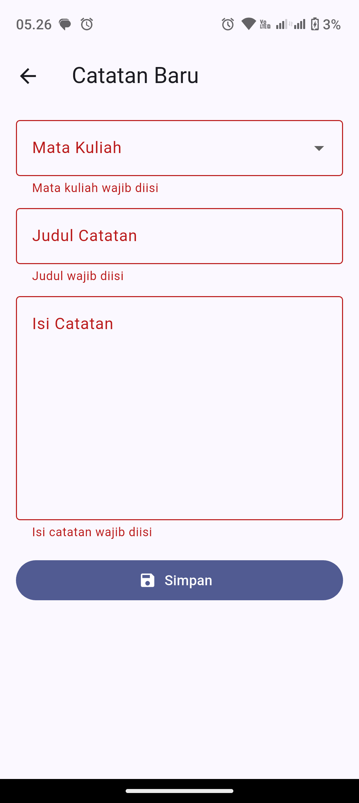
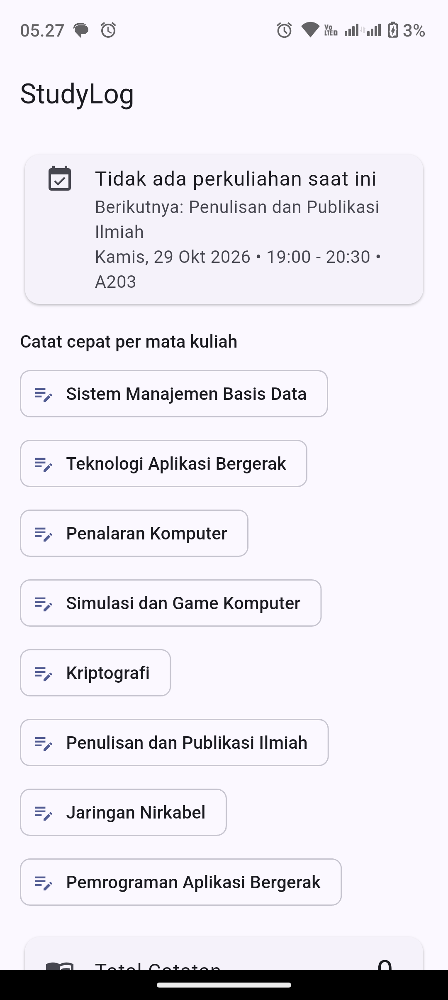
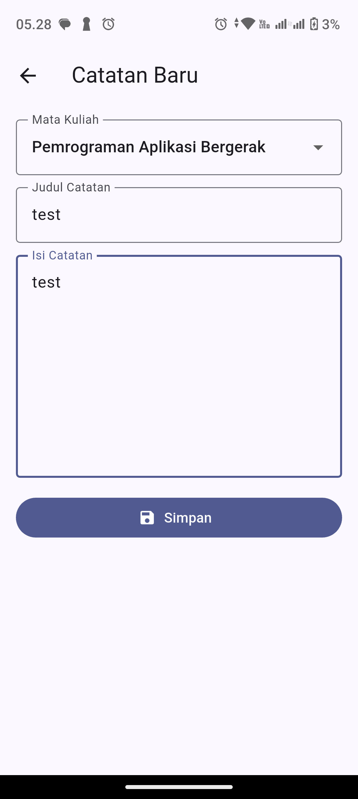
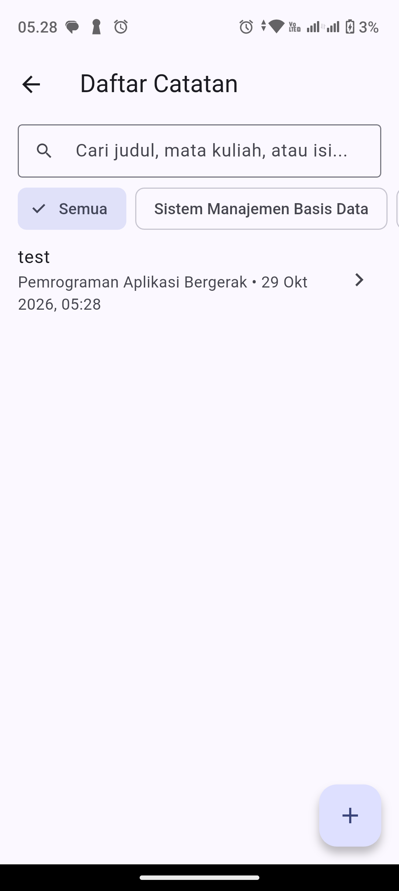
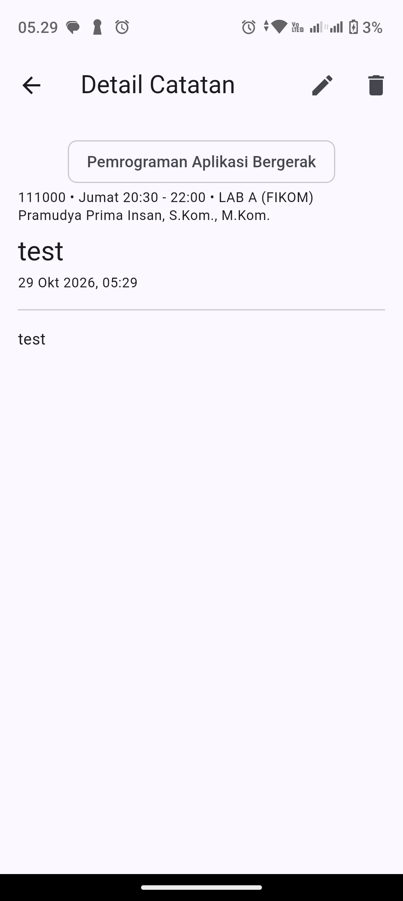
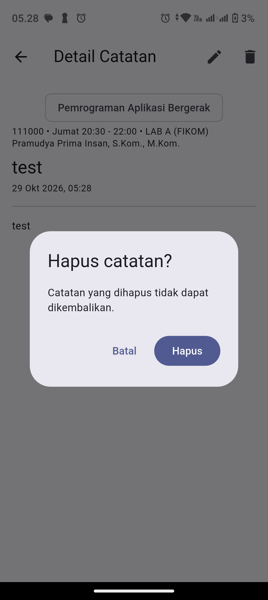

# Laporan Workbook Praktikum & Proyek Akhir: StudyLog

**Mata Kuliah:** Pemrograman Aplikasi Bergerak  
**Program Studi:** Informatika — Universitas Mulia  
**Edisi:** Pembelajaran Terpadu 2026  

---

## Identitas Mahasiswa dan Kelompok

| Isian | Data Mahasiswa |
|---|---|
| **Nama / NIM** | 1. **Ryanda Hermawan** (`2411068`) 2. **Dewi Nofitta Sari** (`2411065`) 3. **Bintang Sahda Rayyu Sonora** (`2411025`) |
| **Kelas / Kelompok** | IFB5J — Kelompok StudyLog |
| **Anggota tim / peran** | • **Ryanda Hermawan:** Arsitektur SQLite 3 Tabel Relasional, Migrasi Skema & Git • **Dewi Nofitta Sari:** Desain Antarmuka Multi-Layar, Form Validasi & State Provider • **Bintang Sahda Rayyu Sonora:** Pengujian Sistem (Unit/Widget/Device), Video Demo & Dokumentasi |
| **Repository GitHub** | [https://github.com/rillsussy/studylog](https://github.com/rillsussy/studylog) |
| **Perangkat uji / Android** | Ponsel Android Fisik (USB Debugging / APK Debug) |
| **Tautan Video Demo** | [https://youtu.be/TQ_v1NJ2w4k](https://youtu.be/TQ_v1NJ2w4k) |

---

## 1. Praktikum 1 — Form Interaktif, State, dan Validasi (Checkpoint M1)

### 1.1 Uji Praktik M1 (Bab 3.4 Workbook)

| ID | Skenario | Hasil yang Diharapkan | Status |
|:---:|---|---|:---:|
| **M1-T1** | Semua field kosong, klik tombol Simpan | Pesan wajib diisi tampil pada setiap field wajib | ☑ Lulus |
| **M1-T2** | Satu field berisi karakter spasi saja (`   `) | Validasi `trim().isEmpty` menolak input | ☑ Lulus |
| **M1-T3** | Semua field terisi valid (termasuk Topik ≥ 3 karakter bila diisi) | Data diproses, status tombol berubah, dan `SnackBar` muncul | ☑ Lulus |
| **M1-T4** | Ubah judul catatan, lalu simpan kembali | Judul catatan diperbarui di tampilan | ☑ Lulus |

### 1.2 Latihan Mandiri Bab 3.5
1. **Field "Topik" dengan validasi minimal 3 karakter:** Ditambahkan pada [`lib/screens/form_catatan_page.dart`](../lib/screens/form_catatan_page.dart) (`Key('field_topik')`) yang memeriksa panjang teks `value.trim().length < 3` dan menampilkan pesan `'Topik minimal 3 karakter'`.
2. **Perubahan warna/ikon tombol saat berhasil menyimpan:** Tombol `FilledButton.icon` berubah menggunakan `Icons.check_circle` dan warna hijau ketika proses simpan berhasil dijalankan.
3. **Mengapa `setState()` tidak sama dengan database dan bukan penyimpanan permanen?**  
   `setState()` hanya memperbarui variabel di memori kerja sementara (RAM) milik objek `State` yang sedang aktif dan menjadwalkan pembangunan ulang (*rebuild*) pohon widget di layar. Begitu proses aplikasi dihentikan oleh sistem operasi Android (*force stop* / tutup paksa), seluruh alokasi RAM aplikasi dibersihkan sehingga data hilang. Penyimpanan permanen memerlukan penulisan ke media penyimpanan non-volatil perangkat (*flash storage*), seperti berkas database SQLite.

---

## 2. Praktikum 2 — Navigasi, Lifecycle, dan State (Checkpoint M2)

### 2.1 Tabel Observasi Lifecycle (Bab 4.6 Workbook)

| Kejadian | Prediksi Mahasiswa | Hasil Aktual |
|---|---|---|
| **Navigasi Beranda → Daftar → Detail** | `Navigator.push` menumpuk route di *back stack*; tombol kembali (`pop`) mengembalikan ke Daftar terlebih dahulu, lalu ke Beranda. | Sesuai prediksi. Urutan kembali konsisten mengikuti *back stack* (`Detail → Daftar → Beranda`), tidak melompat langsung ke awal. |
| **Rotasi layar / rebuild widget** | Widget dibangun ulang menyesuaikan ukuran baru, tetapi objek `ChangeNotifier` di tingkat atas (`Provider`) tetap hidup sehingga daftar catatan tetap tampil. | Sesuai prediksi. Seluruh daftar catatan dan filter tetap terjaga saat layar berotasi maupun saat terjadi *rebuild*. |
| **Hot Reload** | Kode tampilan diperbarui ke VM Dart tanpa menjalankan ulang `main()`, sehingga state di memori tetap bertahan. | Sesuai prediksi. Perubahan teks/UI langsung terlihat dalam hitungan sub-detik sementara data sesi debug tetap utuh. |
| **Force stop lalu buka ulang aplikasi** | Pada tahap M2 (*in-memory*), seluruh isi RAM hilang sehingga daftar kembali kosong. Pada tahap M3 (SQLite), data dibaca ulang dari `studylog.db` dan tetap utuh. | Sesuai prediksi. Di M2 data hilang saat aplikasi dimatikan total; setelah beralih ke SQLite pada M3, seluruh catatan tetap tersedia saat aplikasi dibuka kembali. |

### 2.2 Tugas Pengayaan Bab 4.7
- **Halaman "Tentang Aplikasi":** Diimplementasikan pada [`lib/screens/tentang_page.dart`](../lib/screens/tentang_page.dart) dan dihubungkan langsung melalui ikon informasi pada `AppBar` halaman Beranda.
- **Jumlah Total Catatan dengan `Consumer`:** Ditampilkan secara reaktif menggunakan `Consumer<CatatanViewModel>` baik pada Beranda maupun bagian atas halaman Daftar Catatan (`Total catatan: N`).

---

## 3. Praktikum 3 — SQLite, Repository, dan CRUD (Checkpoint M3)

### 3.1 Matriks Pengujian CRUD & Persistensi (Bab 5.10 Workbook)

| Kasus | Langkah Uji | Ekspektasi | Hasil | Bukti Pengujian |
|---|---|---|---|---|
| **T1 — Create** | Input Mata Kuliah, Judul, dan Isi lalu tekan Simpan | Item baru tersimpan ke SQLite dan muncul di Daftar | ☑ Lulus | Uji perangkat & `widget_test.dart` |
| **T2 — Read** | Buka Daftar Catatan lalu ketuk item ke Detail | Rincian judul, mata kuliah, kategori, waktu, dan isi sesuai input | ☑ Lulus | Uji perangkat & `widget_test.dart` |
| **T3 — Update** | Ketuk ikon Ubah di Detail, ganti judul, lalu Simpan | Perubahan tersimpan ke SQLite dan langsung tampil terbaru | ☑ Lulus | Uji perangkat & `widget_test.dart` |
| **T4 — Delete batal** | Ketuk ikon Hapus di Detail lalu pilih **Batal** pada dialog | Dialog tertutup dan item **tidak** dihapus | ☑ Lulus | Uji perangkat & `widget_test.dart` |
| **T5 — Delete setuju** | Ketuk ikon Hapus di Detail lalu pilih **Hapus** pada dialog | Item terpilih hilang dari daftar & terhapus dari SQLite | ☑ Lulus | Uji perangkat & `widget_test.dart` |
| **T6 — Persistence** | Tambah catatan, tutup paksa aplikasi (*swipe recent apps / force stop*), lalu buka ulang | Catatan tetap tersedia utuh tanpa koneksi internet | ☑ Lulus | Uji perangkat Android & `database_migrasi_test.dart` |
| **T7 — Validasi** | Tekan Simpan saat field kosong / berisi spasi / topik 2 huruf | Pesan kesalahan validasi tampil dan penyimpanan dicegah | ☑ Lulus | Screenshot `01` & `widget_test.dart` |

---

## 4. Dokumentasi Tangkapan Layar (Screenshots Perangkat Android)

### 4.1 Validasi Form (M1 & M3-T7)
Menampilkan pesan kesalahan validasi ketika field wajib dibiarkan kosong.  

### 4.2 Beranda, Jadwal Kuliah Berikutnya, & Tombol Cepat 8 Mata Kuliah
Menampilkan status jadwal real-time serta pintasan cepat mencatat tiap mata kuliah kelas IFB5J.  

### 4.3 Formulir Tambah Catatan
Pemilihan mata kuliah dan pengisian catatan perkuliahan.  

### 4.4 Daftar Catatan, Pencarian, dan Filter
Menampilkan daftar catatan yang tersimpan di SQLite beserta kolom pencarian dan chip filter.  

### 4.5 Detail Catatan & Informasi Relasi Jadwal
Menampilkan isi catatan lengkap beserta informasi kode MK, hari, jam, ruang, dan dosen pengampu dari tabel relasi.  

### 4.6 Dialog Konfirmasi Hapus (T4 & T5)
Dialog pengaman dengan pilihan **Batal** dan **Hapus** sebelum menghapus baris dari SQLite.  

---

## 5. PjBL — Pengembangan Mandiri StudyLog (Bab 6 Workbook)

### 5.1 Cakupan Pengembangan Pilihan (Bab 6.2 Workbook)

| Fitur Pengembangan | Indikator Keberhasilan | Tingkat | Status di StudyLog |
|---|---|:---:|:---:|
| **Cari catatan** | Daftar terfilter berdasarkan kata kunci judul/mata kuliah/topik/isi | Dasar | ☑ Selesai |
| **Urutkan catatan** | Urutan **Terbaru** / **Terlama** dapat dipilih dari AppBar Daftar | Dasar | ☑ Selesai |
| **Kategori / mata kuliah** | Pengelompokan dan filter chip berdasarkan mata kuliah & kategori | Menengah | ☑ Selesai |
| **Tandai favorit** | Status bintang favorit tersimpan di SQLite & bertahan setelah restart | Menengah | ☑ Selesai |
| **Tiga tabel relasional** | Skema relasi `jadwal` (MK), `catatan`, dan `kategori` (tag) + migrasi `v1 → v2 → v3` | Lanjutan | ☑ Selesai |
| **Ekspor teks** | Catatan dapat disalin ke papan klip (*clipboard*) dalam format rapi | Lanjutan | ☑ Selesai |
| **Inovasi: Catat Sekarang** | Deteksi jam kuliah aktif otomatis sehingga mahasiswa langsung mencatat tanpa mencari MK | Unggulan | ☑ Selesai |

### 5.2 Backlog PjBL (Bab 6.3 Workbook)

| ID | Kebutuhan Pengguna (*User Story*) | Penanggung Jawab | Status |
|:---:|---|---|:---:|
| **US-01** | Sebagai mahasiswa, saya ingin menambah catatan agar isi kuliah terdokumentasi secara offline. | Ryanda Hermawan | Selesai |
| **US-02** | Sebagai mahasiswa, saya ingin mengedit dan menghapus catatan dengan konfirmasi agar kesalahan dapat diperbaiki dengan aman. | Dewi Nofitta Sari | Selesai |
| **US-03** | Sebagai mahasiswa, saya ingin mencari catatan berdasarkan kata kunci dan mengurutkan terbaru/terlama agar materi mudah ditemukan kembali. | Bintang Sahda Rayyu Sonora | Selesai |
| **US-04** | Sebagai mahasiswa kelas malam IFB5J, saya ingin aplikasi otomatis mengenali mata kuliah yang sedang berlangsung saat dibuka agar saya langsung bisa mengetik catatan tanpa mencari mata kuliah dulu. | Ryanda Hermawan | Selesai |
| **US-05** | Sebagai mahasiswa, saya ingin mengelompokkan catatan ke dalam kategori/tag (*Materi Kuliah, Praktikum, Tugas, Kuis & Ujian, Rangkuman*) pada skema tiga tabel relasional. | Dewi Nofitta Sari | Selesai |
| **US-06** | Sebagai mahasiswa, saya ingin menandai catatan penting sebagai Favorit dan menyalin (*ekspor*) teks catatan agar mudah dipelajari menjelang ujian. | Bintang Sahda Rayyu Sonora | Selesai |

### 5.3 Ringkasan Pengujian Otomatis (`flutter analyze` & `flutter test`)
- `flutter analyze`: **No issues found!**
- `flutter test`: Seluruh berkas pengujian lulus (`catatan_model_test.dart`, `catatan_repository_test.dart`, `database_migrasi_test.dart`, `status_kuliah_test.dart`, `widget_test.dart`).

---

## 6. Diagnostik Kesalahan & Logbook Debugging (Bab 7.1 Workbook)

| Tanggal / Tahap | Error / Observasi | Dugaan Penyebab | Solusi yang Diuji | Hasil |
|---|---|---|---|---|
| **29 Okt 2026 / M3** | `StateError: databaseFactory not initialized` saat menjalankan `widget_test.dart` | Konstruktor `DatabaseHelper` membaca getter global `databaseFactory` milik `sqflite` secara *eager* padahal lingkungan widget test tidak menjalankan engine Android. | Mengubah resolusi `_factory` menjadi *lazy getter* yang baru dipanggil ketika koneksi database benar-benar dibuka, serta membuat `FakeCatatanRepository` untuk widget test. | **Teratasi** — Widget test dan repository test (FFI) sama-sama berjalan bersih. |
| **29 Okt 2026 / Ekstensi** | `WidgetController.tap` gagal menemukan tombol Simpan pada `widget_test.dart` | Ukuran layar default lingkungan test (`800x600`) terlalu pendek ketika chip mata kuliah & form ditampilkan sehingga tombol berada di luar *viewport*. | Mengatur ukuran layar uji proporsional ponsel modern (`1080x2400`, rasio `2.0`) dengan `addTearDown(tester.view.reset)`. | **Teratasi** — Seluruh interaksi ketuk pada form dan daftar berjalan akurat. |
| **29 Okt 2026 / Pencarian** | Potensi hasil pencarian lama menimpa hasil ketikan terbaru saat pengguna mengetik cepat | Operasi `Future` kueri SQLite bersifat asinkron; kueri sebelumnya bisa selesai belakangan (*race condition*). | Menambahkan penghitung token permintaan (`_permintaan`) pada `CatatanViewModel.muatCatatan()` dan mengabaikan respons usang bila `token != _permintaan`. | **Teratasi** — Daftar hasil pencarian selalu konsisten dengan ketikan terakhir. |
| **30 Okt 2026 / Skema v3** | Penambahan tabel ke-3 (`kategori`) serta kolom `favorit` dan `topik` pada aplikasi yang sudah memiliki database versi sebelumnya | Jika hanya mengubah `CREATE TABLE` pada `onCreate`, perangkat yang sudah memasang versi lama tidak akan memiliki tabel/kolom baru (`DatabaseException: no such table/column`). | Menaikkan versi DB ke `3` dan mengimplementasikan migrasi bertahap di `_onUpgrade` (`oldVersion < 2` dan `oldVersion < 3`) dengan `ALTER TABLE` + seed kategori awal tanpa menghapus data lama. | **Teratasi** — Dibuktikan lewat tes otomatis `database_migrasi_test.dart` (`v1 → v3`). |

---

## 7. Refleksi Individual (Bab 8.3 Workbook)

### 1. Apa perbedaan `setState` dan `ChangeNotifier` yang Anda amati dalam praktik?
**Jawaban:**  
`setState` mengelola *ephemeral/local state* yang hanya dibutuhkan di dalam satu `StatefulWidget` saja (misalnya status tombol `_menyimpan` atau visibilitas tombol hapus teks pencarian). Sebaliknya, `ChangeNotifier` (yang didistribusikan melalui `Provider` dan dibaca oleh `Consumer`/`context.watch`) mengelola *app/shared state* di luar pohon widget sehingga perubahan data dari `FormCatatanPage` atau `DetailCatatanPage` otomatis memberi tahu (`notifyListeners()`) `DaftarCatatanPage` dan `BerandaPage` tanpa harus mengoper callback berlapis-lapis antarhalaman.

### 2. Apa fungsi `Navigator.push` dan `Navigator.pop` pada alur aplikasi?
**Jawaban:**  
`Navigator` mengelola tumpukan halaman (*back stack* dengan prinsip LIFO — *Last In, First Out*). `Navigator.push` menempatkan route halaman baru di puncak tumpukan (misalnya `Beranda → Daftar → Detail → Form Ubah`), sedangkan `Navigator.pop` menutup halaman teratas dan mengembalikan pengguna tepat ke halaman sebelumnya (misalnya selesai menyimpan di Form kembali ke Detail/Daftar, atau menekan kembali dari Detail kembali ke Daftar, bukan mengulang aplikasi dari Beranda).

### 3. Mengapa `ChangeNotifier` tidak otomatis membuat data tetap ada setelah restart penuh?
**Jawaban:**  
Karena objek `ChangeNotifier` beserta koleksi `List<Catatan>` di dalamnya hanya hidup di memori volatil (RAM) selama proses aplikasi berjalan. Saat pengguna melakukan *force stop* atau sistem operasi mematikan proses aplikasi, seluruh isi RAM aplikasi dihapus. Agar data bertahan melampaui siklus hidup proses aplikasi, perubahan state harus ditulis ke penyimpanan persisten pada perangkat (berkas database SQLite `studylog.db`) dan dimuat ulang saat aplikasi kembali dijalankan.

### 4. Apa tanggung jawab `DatabaseHelper` dibanding `Repository` dan `ViewModel`?
**Jawaban:**  
- **`DatabaseHelper`:** Bertanggung jawab murni pada infrastruktur koneksi SQLite: menentukan lokasi file `studylog.db`, mengaktifkan `PRAGMA foreign_keys = ON`, membuat tabel awal (`onCreate`), melakukan migrasi versi skema (`onUpgrade` v1→v2→v3), serta mengisi data awal (*seeding* jadwal & kategori).
- **`Repository` (`CatatanRepository`, `JadwalRepository`, `KategoriRepository`):** Menyediakan antarmuka akses data bersih berbahasa domain objek Dart (`Catatan`, `Jadwal`, `Kategori`), menerjemahkan operasi CRUD/filter/pencarian menjadi query SQL berparameter (`whereArgs`) yang aman, dan mengonversi `Map` ke model lewat `fromMap`/`toMap`.
- **`ViewModel` (`CatatanViewModel`, `JadwalViewModel`, `KategoriViewModel`):** Menjembatani tampilan UI dengan Repository, mengelola status pemuatan (`isLoading`), pesan kesalahan (`error`), state filter/urutan aktif, dan memanggil `notifyListeners()` agar UI membangun ulang tampilan saat data berubah.

### 5. Bug paling sulit apa yang ditemukan, bagaimana Anda membuktikan perbaikannya?
**Jawaban:**  
Masalah paling menantang adalah menjaga kompatibilitas migrasi skema database SQLite dari satu tabel dasar (`v1`) ke dua tabel (`v2`) hingga tiga tabel relasional (`v3`: `jadwal`, `kategori`, `catatan`) tanpa mengorbankan catatan lama milik pengguna, serta mengisolasi inisialisasi `databaseFactory` agar pengujian widget dan pengujian SQLite FFI sama-sama dapat berjalan otomatis. Perbaikannya dibuktikan melalui pengujian terotomatisasi pada `test/database_migrasi_test.dart` yang secara eksplisit membangun database versi 1 di disk sementara, menyisipkan catatan lama, lalu membukanya melalui `DatabaseHelper` versi 3 dan memverifikasi bahwa catatan lama tetap utuh sekaligus otomatis tertaut ke `jadwal_id` dan `kategori_id` yang tepat.

### 6. Apa kontribusi kode dan pengujian yang paling jelas menunjukkan peran Anda?
**Jawaban:**  
Merancang dan mengimplementasikan keseluruhan arsitektur berlapis aplikasi **StudyLog** dari tahap M1 hingga M3 beserta perluasan PjBL 3 tabel relasional, khususnya fitur kontekstual **"Catat Sekarang"** (`lib/utils/status_kuliah.dart`, `lib/viewmodels/jadwal_view_model.dart`, `lib/screens/beranda_page.dart`, dan `lib/screens/form_catatan_page.dart`) yang mencocokkan waktu perangkat dengan jadwal kuliah kelas IFB5J secara otomatis, ditambah rangkaian pengujian otomatis menyeluruh (model, repository SQLite FFI, migrasi skema antarversi, logika jadwal, dan alur penuh widget CRUD).
